<p align="center">
  <picture>
    <source media="(prefers-color-scheme: dark)" srcset="brand/final/aven-horizontal-dark.svg">
    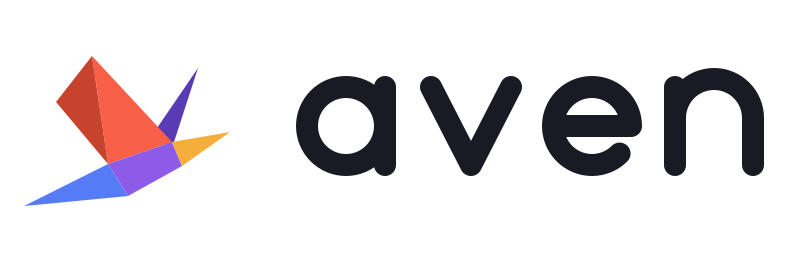
  </picture>
</p>

<p align="center">
  <b>A local-first desktop workspace for visual thinking.</b><br>
  An infinite whiteboard, Kanban boards and Markdown notes, linked together and organised in projects on your own disk.
</p>

<p align="center">
  
  
  
  
</p>

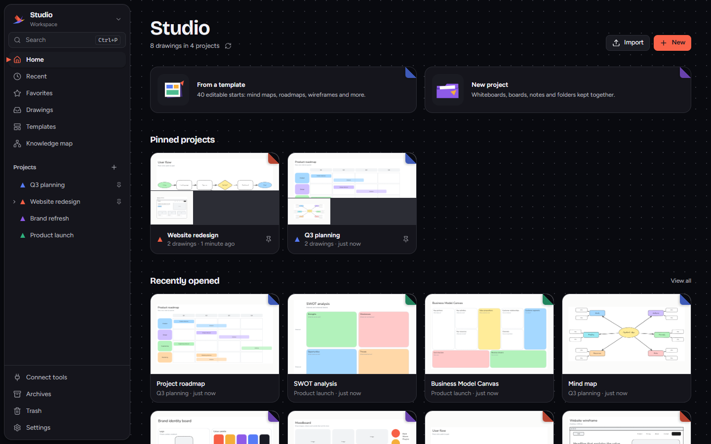

Aven pairs an infinite drawing canvas (built on the open-source Excalidraw engine) with Kanban boards, Markdown notes and a real project manager. Your whiteboards, boards and notes are ordinary files (`.aven`, `.avenboard`, `.md`) in a folder you choose, with autosave, version history and backups. Everything essential works offline; nothing leaves your computer unless you export it.

## Highlights

### Projects, folders and a home for your work

Workspaces live in folders you pick. Inside them: projects with colours and descriptions, nested folders, favourites, pins, archives, a trash with restore, fast search (Ctrl+P) and a knowledge map of drawings that link to each other.

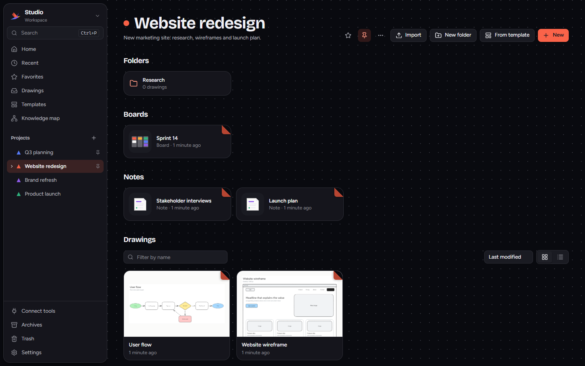

### An infinite canvas

Shapes, arrows, text, images and freehand drawing on an infinite canvas, with optional layers and reusable linked components (Settings › Advanced editing). Rotation snaps back upright, the canvas comes in three looks (dots, off-white, dark), and text can be bold, italic, underlined or struck through.

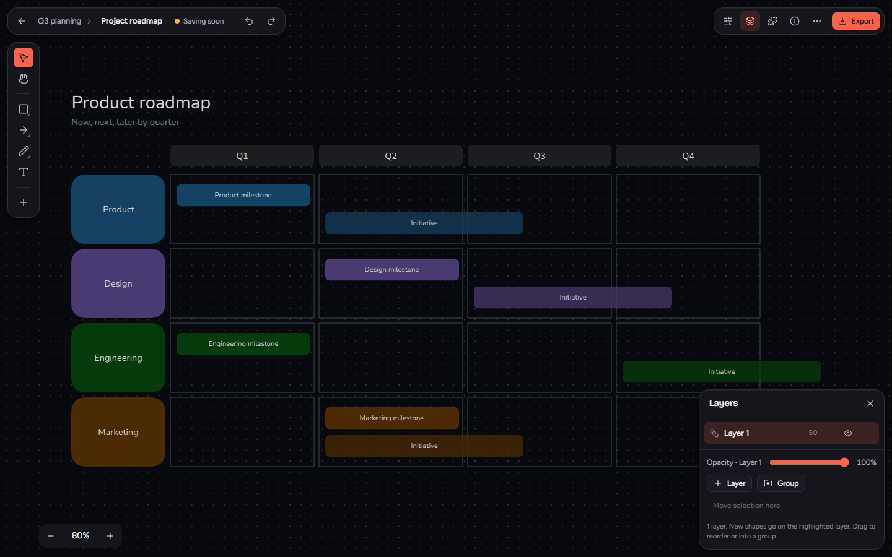

The tool rail stays small: shapes, arrows and drawing tools each share one button that remembers your last choice, and images, frames, diagrams, charts and gauges sit under Insert. Right-click for short, Aven-styled menus.

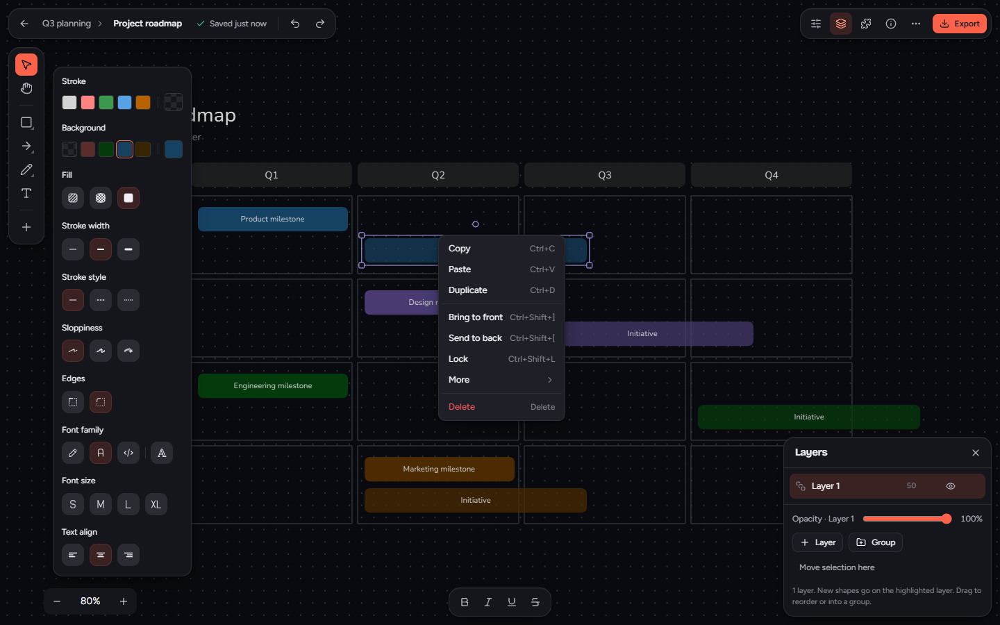

### Kanban boards

Boards sit next to drawings in your projects. Drag cards and columns, add checklists, due dates, labels and links to drawings, set card limits per column, filter by text or label, and export to Markdown, Notion or an Obsidian Kanban board.

<table>
  <tr>
    <td>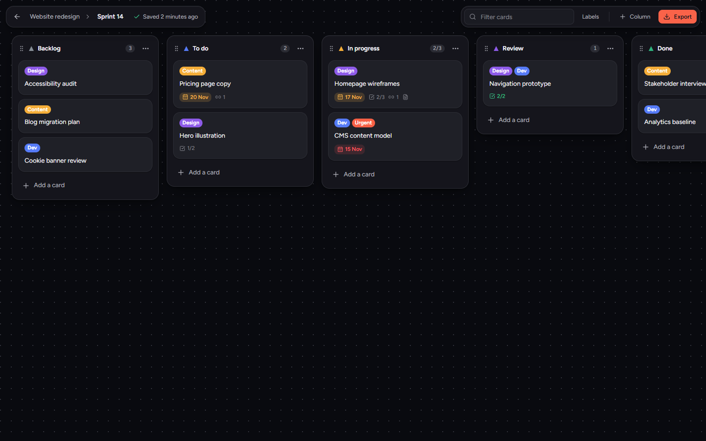</td>
    <td>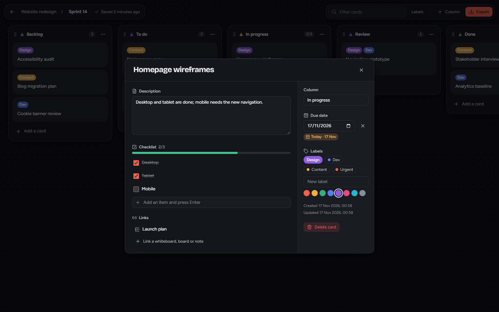</td>
  </tr>
</table>

### Notes, linked to everything

Notes are plain Markdown files that Obsidian, Notion and any editor can read. Formatting shows as you type, the way Obsidian's live preview works: headings, lists, clickable to-dos, quotes and code. Type `/` for commands and `[[` to link a whiteboard, board or note; Kanban cards can link to notes too.

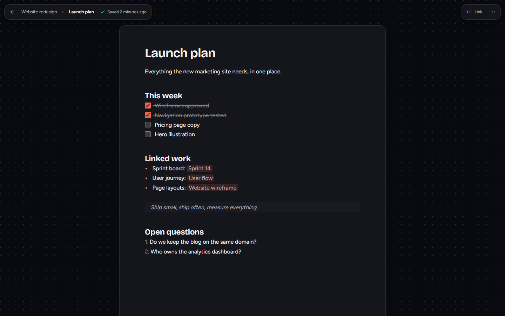

### Charts, tables and gauges that stay editable

Bar, line, pie and donut charts, tables and percentage gauges are made of real canvas shapes. Edit the data in a small spreadsheet (or paste cells from one), switch palettes, and resize: the chart lays itself out again. Duplicates are independent copies.

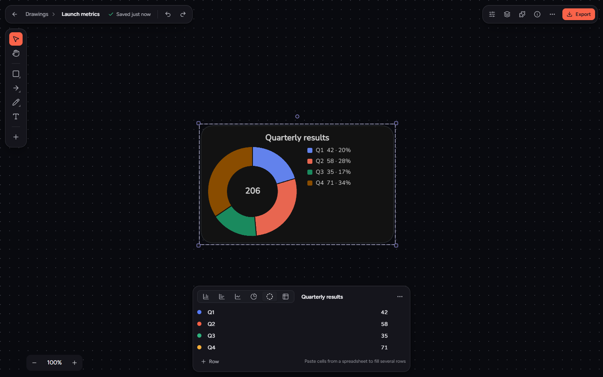

### Diagrams from text

Type an indented list and get a mind map, org chart, plan or flow. Paste Mermaid code (flowchart, sequence, class) and it becomes editable shapes.

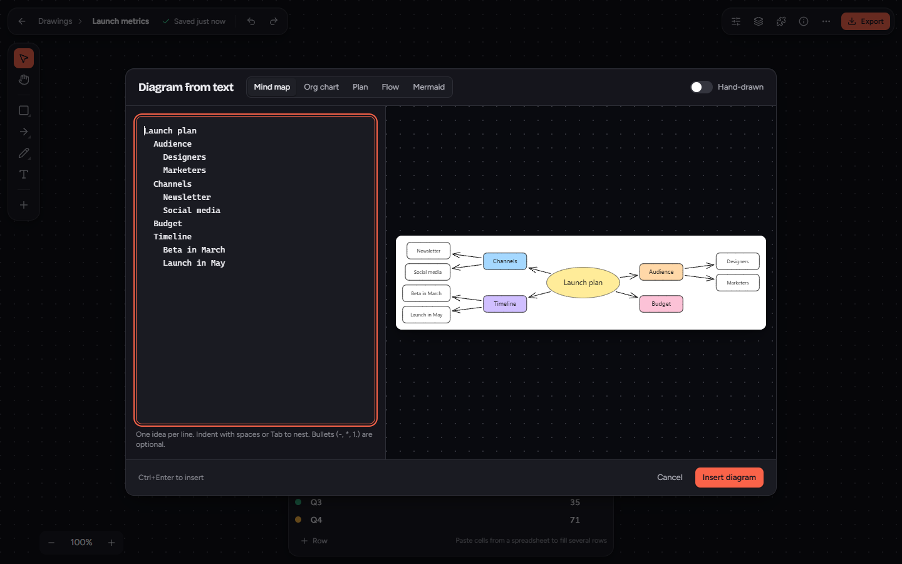

### 40 templates

Mind maps, roadmaps, Gantt plans, user flows, wireframes, moodboards, Business Model Canvas, SWOT, customer journey maps, architecture diagrams and more. Every template is a normal drawing you can edit.

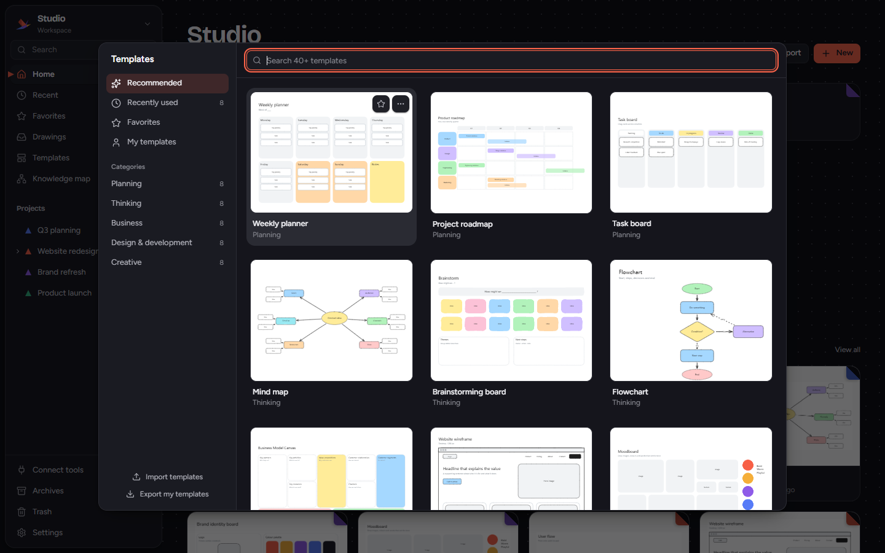

### Export and integrations

PNG, SVG, PDF, JPEG, WebP and JSON exports with scale, padding, background and dark-version options. Send drawings straight to an Obsidian vault (image plus a Markdown note with frontmatter), to Notion, or to Google Drive (through Google Drive for desktop or the Drive API). Built-in step-by-step guides walk you through each connection.

<table>
  <tr>
    <td>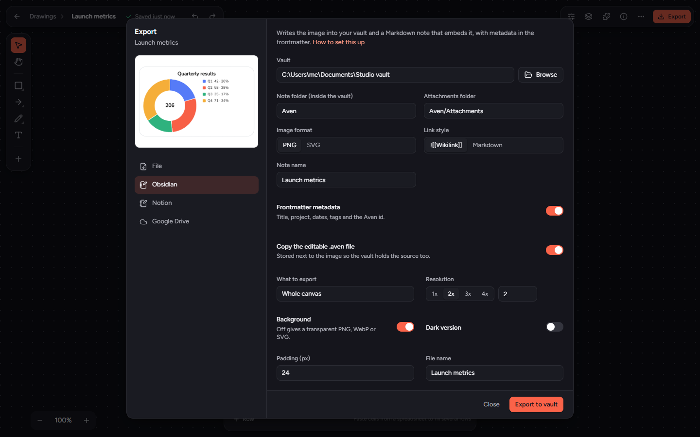</td>
    <td>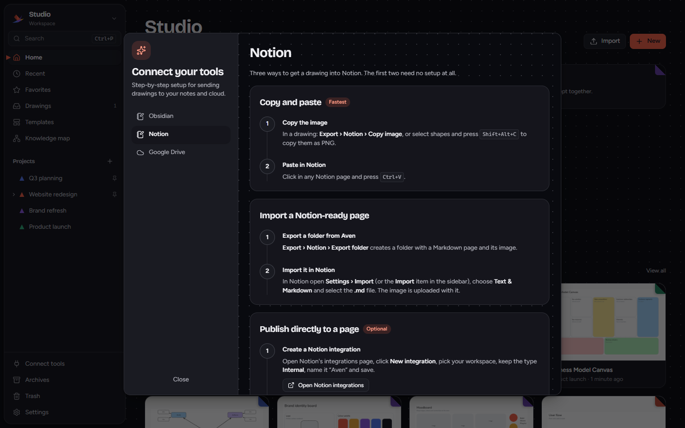</td>
  </tr>
</table>

### Light and dark

The interface follows your Windows theme or your choice, with an accent colour of your own. The canvas look is chosen separately.

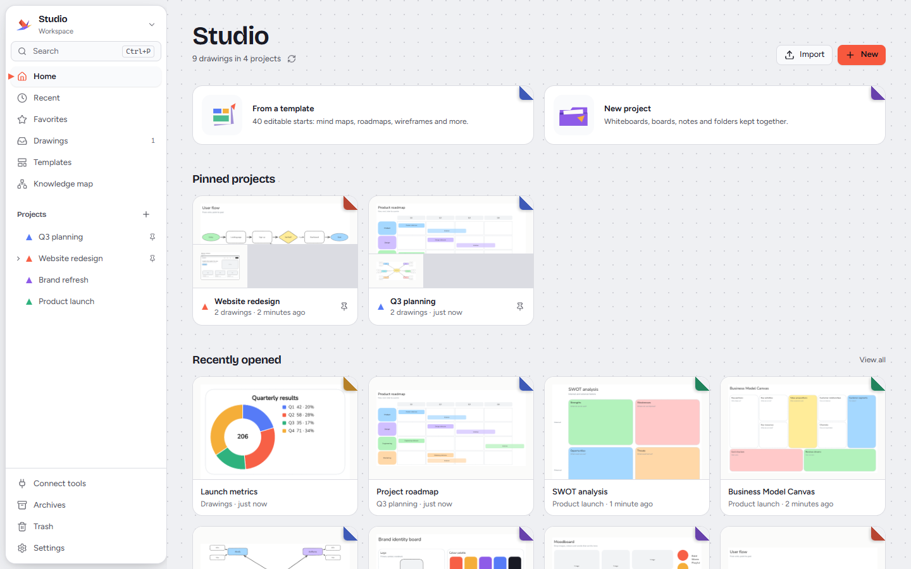

## Your data stays yours

- Plain files in a folder you choose; move it, sync it or back it up like any other folder.
- Atomic saves, crash recovery, version history per drawing, workspace snapshots and a trash with restore.
- No account, no telemetry. Integrations only run when you export.

## Install

1. Download [`Aven_1.3.0_x64-setup.exe`](https://github.com/Kaylloggs/Aven/releases/latest) from the latest release, or build it yourself (see below).
2. Aven installs per user (no admin rights) into `%LOCALAPPDATA%\Aven` and adds a Start menu entry. WebView2 is installed automatically if missing (it ships with Windows 10 and 11).
3. On first launch, choose where your workspace folder lives (default `Documents\Aven\My workspace`).

Uninstall from Windows Settings › Apps. Your workspace folders, settings (`%APPDATA%\app.aven.desktop`) and backups are never removed by the uninstaller or by updates.

The installer is not code-signed, so Windows SmartScreen may ask for confirmation ("More info › Run anyway").

## Development

Requirements: Windows 10/11 x64, Node.js 20+ (tested with 24), Rust stable (MSVC toolchain) with Visual Studio Build Tools (C++ workload), and the WebView2 runtime.

```bash
npm install
```

```bash
npm run app:dev
```

`app:dev` starts Vite on port 1420 and the Tauri shell. `npm run dev` runs only the web UI in a browser, backed by an in-memory mock of the native backend (handy for UI work; nothing is written to disk).

### Tests

```bash
npm test
```

```bash
cd src-tauri && cargo test
```

See [TESTING.md](TESTING.md) for coverage and the manual test plan.

### Build the installer

```bash
npm run app:build
```

Produces `src-tauri/target/release/aven.exe` and the NSIS installer in `src-tauri/target/release/bundle/nsis/`.

Regenerate brand assets with `npm run brand` (writes `brand/final/`), then `npx tauri icon brand/final/png/aven-app-icon.png -o src-tauri/icons` for the app icons.

## Project layout

```
src/                 React + TypeScript frontend
  engine/            document and board formats, charts, gauges, text styles, export, PDF writer
  features/          editor, boards, notes, home, templates, export & integrations, settings, overlays
  platform/          typed bridge to the Rust backend (+ browser mock)
  store/             Zustand stores (settings, workspace, UI)
src-tauri/           Rust backend (Tauri 2): storage, backups, SQLite index, integrations
scripts/             engine asset copy and the small, pinned engine patch for text styles
brand/               logo generator and final brand assets
docs/images/         README screenshots
```

Documentation: [Architecture](ARCHITECTURE.md) · [Features](FEATURES.md) · [Roadmap](ROADMAP.md) · [Testing](TESTING.md) · [Changelog](CHANGELOG.md) · [Product](PRODUCT.md) · [Design](DESIGN.md)

## License

Aven is released under the [MIT License](LICENSE). Its drawing engine is [Excalidraw](https://github.com/excalidraw/excalidraw) (MIT); Aven does not use Excalidraw's branding. Full third-party notices are in [THIRD_PARTY_NOTICES.md](THIRD_PARTY_NOTICES.md) and are installed with the app.
